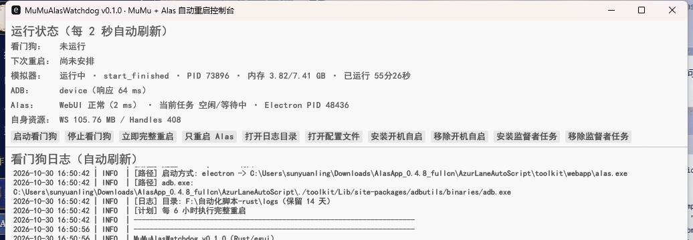

# MuMu + Alas 自动重启看门狗（Rust + egui）

用 Rust + egui 重写的无人值守守护工具：
按计划完成「关 Alas → 重启 MuMu 实例 → 等 ADB 恢复 → 启动 Alas → 自动开始游戏脚本」，
运行期间持续巡检、异常自愈，**不需要 OCR，也不修改 Alas 任何代码**。

> 状态：Rust 版已是正式版（原 Python 版归档到 `F:\自动化脚本-python-legacy`，
> GitHub 上保留 `python-legacy` 分支）。当前运行方式：
> **守护进程无任务栏窗口、常驻系统托盘** + egui 控制台 + 监督者计划任务 + 开机自启。



## 为什么用 Rust + egui

- 无常驻解释器运行时，内存/句柄行为可控，可长时间无人值守；
- 单文件原生 exe，无 PyInstaller 解包与残留进程问题；
- Win32 API 直接调用（`windows-sys`）：进程、句柄、窗口、托盘、启动进程均走原生接口；
- **托盘常驻**：守护进程不显示任务栏窗口，但托盘有图标和右键菜单，不是"完全隐身"；
- egui 原生 GUI + 后台模式，一套二进制同时支持 GUI / CLI；
- 目标：长期无人值守 + 可观测（自身内存、句柄、运行时长阈值自重启）。

## 系统托盘

守护进程启动后会创建一个 **不可见的消息窗口**（`Visible=False`，不占任务栏），
通过 `Shell_NotifyIcon` 注册托盘图标；悬浮提示会显示下次重启时间。

右键菜单：

- 打开控制台（egui GUI，独立窗口）
- 立即完整重启 / 只重启 Alas
- 打开日志目录 / 配置（控制台）
- 退出看门狗

单击托盘图标 = 打开或恢复已有控制台。控制台关闭不影响守护进程；托盘图标会一直保留到看门狗退出。
点击托盘菜单里的"退出看门狗"会走有序退出（清理托盘图标）；托盘线程带 3 秒超时保护，避免菜单卡住导致退出挂起。

> Windows 可能会把新托盘图标收进"隐藏的图标"溢出区（系统设置决定）；可在任务栏设置里把它固定为始终显示。

## 构建

```powershell
cd F:\自动化脚本
cargo build --release
# 产物: target\release\MuMuAlasWatchdog.exe（单文件约 5.4 MB）
# 部署时把 exe 和 icon.ico、config.example.yml 放在同一目录即可
```

首次编译依赖较多（egui 等），之后增量很快。

## 使用

```powershell
# GUI（默认）：双击 MuMuAlasWatchdog.exe 打开控制台
MuMuAlasWatchdog.exe

# CLI
MuMuAlasWatchdog.exe --check
MuMuAlasWatchdog.exe --start          # 后台启动守护进程（托盘出现图标）
MuMuAlasWatchdog.exe --stop
MuMuAlasWatchdog.exe --restart-now
MuMuAlasWatchdog.exe --restart-alas-now
MuMuAlasWatchdog.exe --cli            # 前台 CLI 守护（控制台日志，调试）

# 长期无人值守（推荐同时安装两项）
MuMuAlasWatchdog.exe --install-autostart    # 登录时后台启动
MuMuAlasWatchdog.exe --install-supervisor   # 每 2 分钟 --ensure 兜底
```

`--install-supervisor` 创建名为 `MuMuAlasWatchdog-Supervisor` 的计划任务：
每 2 分钟执行一次 `MuMuAlasWatchdog.exe --ensure`；若看门狗进程不存在则拉起。
配合 `monitor.self_restart_*` 阈值，看门狗在自身资源超限时会记录日志并有序退出，由监督者重新拉起。

## 配置

首次运行从 [config.example.yml](config.example.yml) 复制为 `config.yml`（已被 .gitignore 忽略）。
主要配置与 Python 版一致，额外增加自我监控：

```yaml
monitor:
  status_log_seconds: 300
  write_status_json: true
  self_restart_memory_mb: 200    # 自身工作集超过 200MB 时有序自重启（需监督者）
  self_restart_handles: 1000     # 句柄数上限
  self_restart_after_hours: 24   # 连续运行多久后主动重启一次
```

## 运行状态与日志

- `logs/watchdog_YYYYMMDD.log`：按天滚动，保留 14 天；
- `status.json`：模拟器 / ADB / Alas / 看门狗自身资源 / 上次重启结果；
- 每 `monitor.status_log_seconds` 输出一条状态日志，包含自身 WS/Private/Handles；
- 托盘提示同步显示"下次重启时间"。

## 目录结构

```text
F:\自动化脚本\
├─ main.rs / lib.rs        # 入口与模块导出
├─ cli.rs                  # CLI 子命令（GUI/CLI 双模式）
├─ gui.rs                  # egui 控制台
├─ tray.rs                 # 系统托盘（隐藏窗口 + Shell_NotifyIcon + 右键菜单）
├─ watchdog.rs             # 主编排：重启流程、巡检、调度、自监控、单实例锁
├─ emulator.rs             # MuMuManager CLI 封装、启停、ADB 等待
├─ alas.rs                 # Alas 进程识别/结束、Win32 启动、WebUI 就绪
├─ logwatch.rs             # Alas 日志增量读取、任务状态、调度器等待
├─ schedule.rs             # 重启计划纯函数（可单测）
├─ config.rs               # config.yml 读取
├─ layout.rs               # 环境探测（Alas/MuMu/实例/ADB/端口）
├─ win32.rs                # Win32 API：进程枚举/内存/句柄/控制台
├─ status.rs               # 状态采集与 status.json
├─ integrations.rs         # 开机自启、计划任务监督者
├─ logger.rs               # 按天滚动日志 + 自身指标
├─ util.rs / output.rs     # 命令执行、HTTP、路径、输出
├─ icon.ico                # 托盘图标
├─ config.example.yml      # 配置示例
└─ tests/core.rs           # schedule / util 单元测试
```

## 与 Python 版的关系

- Rust 版：`F:\自动化脚本`（当前正式运行版本）
- Python 版：`F:\自动化脚本-python-legacy`（归档保留，可回退）
- GitHub：`main` = Rust 版；`python-legacy` 分支 = 原 Python 版历史

回退方法：先 `MuMuAlasWatchdog.exe --stop` 停 Rust 看门狗，再到
`F:\自动化脚本-python-legacy` 执行 `python -m mumu_alas_watchdog --start` 并重新安装自启。

## 本机验证记录

- `cargo test --release`：7 项单元测试全部通过（计划计算、时间格式、路径规则等）；
- `cargo build --release`：单文件窗口化 exe 约 5.4 MB；
- CLI：`--check` 状态读取正确（模拟器/ADB/WebUI/日志任务状态）；
- `--install-supervisor` / `--uninstall-supervisor`：计划任务创建、查询、删除验证通过；
- GUI：egui 窗口正常渲染（中文字体、状态行、按钮、日志面板）；
- **托盘**：隐藏窗口 `IsWindowVisible=False`（不占任务栏）；
  `Shell_NotifyIconGetRect` 返回成功，图标位于通知区域；
  右键菜单可正常弹出并通过 ESC 关闭；单击打开或恢复控制台；
- 完整重启实测：关 Alas → 关 MuMu → 启动 MuMu → ADB 恢复 → Win32 启动 Alas → 调度器自动开始，
  用时约 40 秒，Alas 日志确认出现 `Start scheduler loop`；
- 当前部署：Rust 守护进程运行中（WS ~15 MB / Handles ~170），
  监督者计划任务每 2 分钟执行 `--ensure`；开机自启指向 `F:\自动化脚本\MuMuAlasWatchdog.exe`。

## 注意

1. 定时重启会中断当前 Alas 任务；
2. 手动玩之前先 `--stop`；
3. 开机自启/监督者任务都依赖当前用户登录会话（MuMu/Alas GUI 需要交互桌面）；
4. 首次在新机器运行前，请在 `config.yml` 确认 `paths.alas_root` / `paths.mumu_manager`；
5. 托盘图标若被 Windows 收进溢出区，可在"任务栏设置 → 选择哪些图标显示在任务栏上"中固定显示。

## GUI 配置

控制台关闭按钮和 Alt+F4 只关闭控制台窗口（GUI 进程退出），**后台看门狗及其托盘图标继续运行**；单击托盘图标或右键选择“打开控制台”即可重新打开控制台。这样既满足“关闭回托盘”，又避免 eframe 隐藏窗口后事件循环空转（实测隐藏窗口会占用 90%+ 单核）。GUI 与后台看门狗各自独立，关闭控制台不会停止守护、巡检或计划重启。

默认打开图形控制台，包含运行概览、配置、运行日志、外观四个页面。配置页可选择 Alas 目录、MuMuManager.exe、adb.exe 和 Alas 配置 JSON，使用开关、下拉框和数值控件调整计划与恢复策略，无需手写 YAML。固定重启时间支持添加、删除及小时/分钟选择。CLI 保留作调试和自动化辅助。

保存前校验路径；保存时保留未知配置键，并将原文件备份为 config.yml.bak（自定义配置文件使用对应文件名）。保存会重写 YAML 格式，原注释保留在备份中。若文件被外部修改，需重新读取后保存。

保存后自动请求后台热重载，也可点击“热重载已保存配置”应用外部编辑后的配置。后台在当前操作完成后的主循环安全点读取同一配置文件，校验成功后更新路径、计划、健康策略、超时与日志设置；不会重新执行启动时拉起或重启操作。相同目标保留日志读取进度、任务状态及冷却时间，目标改变时清理旧目标的待执行恢复。重算计划时沿用首次重启宽限时间。配置或目标解析失败则保留旧参数，并在界面显示失败原因。GUI 以请求 ID 和后台 PID 对应的回执确认生效；超过 120 秒未收到确认会提示等待或检查旧版本，不能据此判断已生效。

GUI 和后台看门狗使用不同的 Windows 会话命名互斥量。重复打开 GUI 会唤起已有窗口；后台并发启动只允许一个实例取得控制权，取得实例锁与 PID 文件后才清理旧控制标记。旧版进程仍需正常退出一次后使用新版，才能获得新增保护和热重载能力。

配置行随窗口宽度展开；窄窗口将标签放到控件上方。路径选择与自动识别按钮统一为相同尺寸。头像参考用户提供的插画，以卡通大头风重新生成；透明 PNG 与多尺寸 ICO 位于 assets/，窗口、任务栏、托盘和 exe 资源使用同一套图标。生成说明见 assets/icon-prompt.md。

中文优先使用 Windows 微软雅黑，正文和日志使用不同字体族；字号按系统 DPI 缩放。

背景采用参考插画扩展的横向庭院场景，内嵌为 assets/background.png。窗口缩放时等比铺满并裁切，横向裁切偏向保留右侧人物，控件上覆盖半透明浅色底。支持最小 680×560 的窗口；配置页窄屏时标签与输入控件纵向排列。背景生成说明见 assets/background-prompt.md。

“外观”页支持独立调整背景透明度与控件透明度，拖动实时预览；0% 表示不透明，100% 表示完全透明。默认背景透明度 0%、控件透明度 55%。已去除整页白色蒙层，透明度只作用于背景与控件底色，不降低文字透明度。可选择 PNG、JPEG 或 WebP 自定义背景，并恢复内置背景或默认外观。“保存外观”写入程序目录 gui-appearance.json，下次启动自动恢复，不要求后台热重载。自定义背景按路径引用，文件丢失或无法解码时回退内置背景并显示原因；图片限 32 MB、边长 8192 像素。窗口仍按等比铺满裁切。

控件底色采用淡蓝色，并按当前渲染器的伽马空间预乘方式处理透明度，避免中间透明度叠加后异常提亮。两个透明度滑块保留独立的淡蓝色底板、完整滑轨、已选区间填充和带底色的数值；这些定位控件不随全局透明度淡出，便于在全透明或复杂背景上继续调整。

通用底板颜色统一为用户指定的 #0096FA。运行概览、配置、日志、外观页面共用铺满可用内容区的同一底板，不再按短内容收缩或将日志直接画在背景图上。外观滑轨随可用宽度展开，使用 #0096FA 和白色文字。

文字颜色覆盖四个页面的标题、说明、状态、配置标签、日志正文及公共导航和底栏，统一按控件底色与透明度反转，不再只修改按钮。禁用按钮继续使用禁用效果，错误提示保留错误色。滑轨、已选区间、滑块及数值底色统一采用 #0096FA，滑块使用白色描边，去除原灰蓝配色。

## 界面代码结构

- src/gui.rs：原生窗口入口和单实例恢复。
- src/gui/app.rs：界面状态、配置重载与操作编排；app/lifecycle.rs 负责托盘关闭行为和公共导航，app/status.rs 负责状态文本格式化。
- src/gui/app/pages/：四个页面只负责内容与布局，不设置文字颜色；页面路由集中在 mod.rs。
- src/gui/theme/：统一管理 #0096FA 配色、交互状态、文字前景色、字体尺寸和共用底板/滑条。text.rs 按控件自身底色和透明度计算前景色，避免以背景图片平均色判断蓝色文字区域。页面继承 egui 同一套文字渲染与主题，不重复维护颜色规则。
- src/gui/background.rs、fonts.rs、worker.rs：分别负责图片解码与裁切、中文字体、只读状态轮询。
- src/appearance.rs：仅保存外观配置模型及文件读写，不依赖 egui。
- src/config_editor.rs 和 src/config_editor/：配置草稿与保存、字段控件、中文标签、测试分别维护。

绘制回归检查直接运行公共渲染入口，覆盖四个页面及导航/底栏，在 0%、54%、55%、84%、100% 透明度下验证实际文字绘制颜色。此检查不启动原生窗口，不能代替实际窗口视觉验收。

透明度反转规则：文字主题同时接收控件自身底色和透明度。当前蓝色控件在透明度低于 65% 时使用白字，达到 65% 后统一切换深色字；正文、标题、导航、消息、表单以及按钮普通/悬停/按下/选中状态共用这一规则。滑条及其数值框本身为固定不透明的 #0096FA，因此保持白字，不跟随外围容器的透明度切换。回归检查覆盖 64%/65% 临界点及四个页面实际文字输出。

## 正式入口与内存优化（2026-10-30）

正式入口统一为程序根目录的 MuMuAlasWatchdog.exe，GUI、后台、自启快捷方式及每五分钟执行的监督任务均使用此文件。旧 opacity、preview、review 预览产物与替换时暂存的旧程序已清理；target/release 中同名文件是本次构建输出，与根目录程序 SHA256 相同。

中文字体通过进程生命周期内的只读文件映射共享系统字体，交给 egui 借用，避免读取与字体解析时重复复制整份 TTC。状态轮询只保留最新一份待处理快照，避免窗口隐藏时消息积压；后台状态可用时，GUI 直接使用后台快照，不再维护重复的 Watchdog 扫描器。

同一机器、同一外观设置，分别重新启动旧、新 GUI 后第 12 秒采样：

| 指标 | 旧 GUI | 正式 GUI | 降幅 |
| --- | ---: | ---: | ---: |
| 工作集 | 124.96 MiB | 88.37 MiB | 29.28% |
| 私有内存 | 125.20 MiB | 88.32 MiB | 29.46% |

正式后台独立采样工作集 15.98 MiB、私有内存 2.89 MiB。详细采样保留在 target/memory-comparison.json。这是启动阶段对照，不能代替长时间驻留验证。原生 Rust 程序仍需保存解码图片、字体图集和窗口绘制资源，内存占用不等于可执行文件大小。优化未降低背景分辨率或强制清空工作集。
