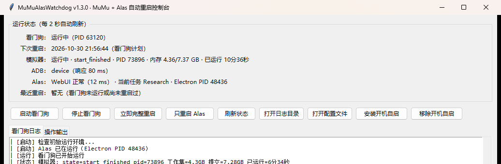

# MuMu + Alas 自动重启看门狗

解决 **MuMu 模拟器长时间运行后卡死 / 内存泄漏导致 Alas 卡任务** 的问题：
按计划自动完成「关 Alas → 重启 MuMu 实例 → 等 ADB 恢复 → 启动 Alas → 自动开始游戏脚本」，
并在运行期间持续巡检、异常自愈。**不需要 OCR，也不需要模拟鼠标点击。**



> 本项目是独立外部工具，**不是 Alas 的钩子，也不修改 Alas 任何代码**。

---

## 一、设计结论：为什么不需要 OCR

| 需求 | 实现方式 | 是否需要 OCR |
| --- | --- | --- |
| 关闭 / 启动指定 MuMu 实例 | MuMu 自带 `MuMuManager.exe`：`info`、`control -v <idx> shutdown/launch`、`adb` | 否 |
| 检测模拟器与 ADB 是否恢复 | `MuMuManager info` 的 `is_process_started/is_android_started/player_state` + `adb get-state`、`getprop sys.boot_completed` | 否 |
| 启动 Alas | 用 **Win32 API `CreateProcessW`** 启动官方 `toolkit/webapp/alas.exe`（或 `Alas.exe` 启动器） | 否 |
| 重启 Alas 后自动开始游戏脚本 | 启动前写入 `config/reloadalas`。这是 Alas 自带机制：`module/webui/process_manager.py` 中 `ProcessManager.restart_processes()` 在 WebUI 启动时读取该文件并自动启动调度器（Alas 自身更新重启后恢复实例也用它，读取后会自行删除） | 否 |
| 判断游戏脚本是否已开始 | 轮询 Alas 日志出现 `Start scheduler loop: <配置名>` | 否 |

与 Alas 只有三个接触点：
1. 只读 `config/deploy.yaml`、`config/alas.json`，自动识别路径/实例/端口；
2. 启动前写一个临时的 `config/reloadalas`（Alas 读取后自行删除）；
3. 通过 Win32 API 启动它的可执行文件。

另外，某些 IDE / 自动化环境会注入 `ELECTRON_RUN_AS_NODE=1`（会让 Electron 以 Node 模式运行后秒退），
本项目启动 Alas 时会显式传入清洗后的环境块，并移除 PyInstaller 的 `_PYI_*` 内部变量，避免污染子进程。

---

## 二、功能

- **定时重启**：默认每 6 小时；也支持每天固定时间点（如 `["04:00", "16:00"]`）。
- **重启流程 6 步**：结束 Alas → 关闭 MuMu 实例 → 启动 MuMu 实例 → 等待 ADB 恢复 → 启动 Alas → 等待脚本自动开始。
- **运行巡检（默认 60 秒）**：
  - ADB 连续异常（默认 3 次）→ 自动完整重启；
  - MuMu 实例意外退出 → 自动重启；
  - Alas 意外退出/崩溃 → 自动重新拉起（可配置冷却时间）；
  - 当前任务长时间无日志（默认 60 分钟，疑似卡死）→ 可配置自动完整重启；
  - 可选：模拟器进程提交内存超过阈值时提前重启。
- **状态可观测**：
  - 定期状态日志：模拟器内存（工作集/提交）、ADB 响应耗时、WebUI 响应耗时、当前 Alas 任务、下次重启时间；
  - `status.json` 机器可读状态，便于其它程序/监控读取；
  - 完整重启流程有分步日志，日志按天分割、保留可配置天数。
- **GUI + CLI 双模式**：双击 exe 打开图形控制台；命令行模式支持状态查看、启停、立即重启、开机自启管理。
- **稳健性**：单实例锁、失败重试退避（连续失败自动加倍）、开机自启、Win32 无 shell 启动、异常自愈。

---

## 三、目录结构（可维护性）

```text
mumu-alas-watchdog/
├─ main.py                         # PyInstaller 打包入口
├─ mumu_alas_watchdog/             # Python 包
│  ├─ cli.py                       # CLI 入口 / 子命令（GUI/CLI 双模式）
│  ├─ gui.py                       # tkinter 控制台
│  ├─ watchdog.py                  # 主编排：重启流程、巡检、调度、守护循环
│  ├─ status.py                    # 状态采集 / status.json / 状态日志
│  ├─ emulator.py                  # MuMuManager CLI 封装、启停、ADB 等待
│  ├─ alas.py                      # Alas 进程识别/结束、Win32 启动、WebUI 就绪
│  ├─ logwatch.py                  # Alas 日志增量读取、任务状态、调度器等待
│  ├─ logparse.py                  # 日志解析纯函数（可单测）
│  ├─ schedule.py                  # 重启计划计算纯函数（可单测）
│  ├─ layout.py                    # 环境探测：Alas 根目录/MuMu/实例/ADB/端口
│  ├─ config.py                    # config.yml 读取（PyYAML）
│  ├─ win32api.py                  # Win32 API：进程枚举/内存/CreateProcessW
│  ├─ util.py                      # 命令执行、HTTP/端口探测、路径/时间工具
│  ├─ lockfile.py                  # 单实例锁 / PID 文件
│  ├─ autostart.py                 # 开机自启快捷方式
│  └─ constants.py                 # 常量与运行路径（源码/exe 自适应）
├─ tests/                          # pytest 单元测试
├─ build_exe.py                    # PyInstaller 打包脚本
├─ pyproject.toml / requirements*.txt
├─ config.example.yml              # 配置示例（首次运行复制为 config.yml）
├─ docs/gui.png                    # GUI 截图
└─ (构建产物 MuMuAlasWatchdog.exe、logs/、status.json 等均被 git 忽略)
```

> 模块之间通过组合注入依赖（Watchdog 组合 MuMuClient / AlasClient / LogWatcher / 状态采集），
> 纯逻辑（schedule、logparse、util）独立可测；GUI 只依赖服务层，不直接操作进程。

---

## 四、快速开始

### 1. 安装依赖 / 准备运行环境

需要 Windows 10/11、Python 3.9+（推荐 3.11）以及已安装好的 MuMu 模拟器与 Alas（AzurLaneAutoScript）。

```powershell
python -m venv .venv
.\.venv\Scripts\python.exe -m pip install -r requirements-dev.txt

# 首次运行会从 config.example.yml 生成 config.yml
.\.venv\Scripts\python.exe -m mumu_alas_watchdog --check
```

如果程序不在 Alas 目录附近，编辑 `config.yml` 填写 `paths.alas_root`（以及可选的 `paths.mumu_manager`）。

### 2. GUI 模式（推荐）

- 源码：`.\.venv\Scripts\python.exe -m mumu_alas_watchdog`
- exe：双击 `MuMuAlasWatchdog.exe`

控制台功能：查看看门狗/模拟器/ADB/Alas 实时状态与日志；启动/停止看门狗；立即完整重启；只重启 Alas；
打开日志目录/配置文件；安装/移除开机自启。

### 3. CLI 模式

```powershell
.\.venv\Scripts\python.exe -m mumu_alas_watchdog --cli      # 前台 CLI 守护（调试）
.\.venv\Scripts\python.exe -m mumu_alas_watchdog --start    # 后台启动
.\.venv\Scripts\python.exe -m mumu_alas_watchdog --stop     # 停止
.\.venv\Scripts\python.exe -m mumu_alas_watchdog --check    # 只读状态检查
.\.venv\Scripts\python.exe -m mumu_alas_watchdog --restart-now       # 立即完整重启
.\.venv\Scripts\python.exe -m mumu_alas_watchdog --restart-alas-now  # 只重启 Alas
.\.venv\Scripts\python.exe -m mumu_alas_watchdog --test-emulator 1   # 用未使用实例测试模拟器控制
.\.venv\Scripts\python.exe -m mumu_alas_watchdog --install-autostart # 开机自启

# exe 模式同理：MuMuAlasWatchdog.exe --check / --start / --stop ...
# 窗口化 exe 的 CLI 输出会附加父控制台；GUI 调用的子命令输出写入临时文件。
```

---

## 五、配置（config.example.yml → config.yml）

`config.yml` 已被 `.gitignore` 忽略，可自由填写本机路径；首次运行会自动从 `config.example.yml` 复制。

| 配置项 | 默认 | 说明 |
| --- | --- | --- |
| `paths.alas_root` | auto | Alas 根目录；auto 会从运行中的 Alas 进程推断 |
| `paths.mumu_manager` | auto | MuMuManager.exe；auto 从 Alas 配置/MuMu 进程推断 |
| `paths.mumu_instance` | auto | MuMu 实例编号；auto 从模拟器名/ADB 端口推断 |
| `paths.adb_exe` | auto | adb.exe；auto 读取 Alas `deploy.yaml` |
| `paths.launch_mode` | electron | electron=直接启动 `toolkit/webapp/alas.exe`；launcher=启动 `Alas.exe` |
| `alas.config_names` | auto | 要自动恢复的 Alas 配置名（对应 `config/<名字>.json`） |
| `schedule.restart_times` | [] | 每天固定时间重启，如 `["04:00", "16:00"]`；空则按间隔 |
| `schedule.restart_interval_hours` | 6 | 间隔重启（小时） |
| `schedule.restart_on_start` | false | 看门狗启动后是否立即完整重启一次 |
| `schedule.ensure_running_on_start` | true | 启动时若模拟器/Alas 未运行则自动拉起 |
| `schedule.startup_grace_minutes` | 10 | 启动时若计划时间已到，宽限多少分钟再执行 |
| `health.check_interval_seconds` | 60 | 巡检间隔 |
| `health.adb_fail_threshold` | 3 | ADB 连续失败多少次触发完整重启 |
| `health.mumu_memory_limit_gb` | 0 | 提交内存超阈值提前重启；0=关闭 |
| `health.restart_if_emulator_down` | true | 模拟器退出是否自动重启 |
| `health.restart_alas_if_closed` | true | Alas 退出是否自动拉起 |
| `health.task_stuck_minutes` | 60 | 任务无日志多少分钟视为卡死；0=关闭 |
| `health.restart_on_task_stuck` | true | 疑似卡死是否自动完整重启 |
| `timeouts.*` | 见文件 | 关模拟器/启动/ADB/Alas/调度器各阶段超时 |
| `process.use_reloadalas` | true | 用 `config/reloadalas` 让 Alas 自动开始脚本 |
| `process.kill_adb_server` | true | 重启前结束 adb server 清除卡死连接 |
| `monitor.status_log_seconds` | 300 | 状态日志/`status.json` 输出间隔 |
| `logging.dir` / `keep_days` | logs / 14 | 日志目录与保留天数 |

配置示例：

```yaml
paths:
  alas_root: C:/path/to/AzurLaneAutoScript
  mumu_manager: F:/path/to/MuMuPlayer/nx_main/MuMuManager.exe
  mumu_instance: 0
  launch_mode: electron
schedule:
  restart_times: ["04:00", "16:00"]   # 也可以留空，用 restart_interval_hours: 6
health:
  mumu_memory_limit_gb: 10            # 可选：超过 10GB 提前重启
```

---

## 六、重启流程与自愈策略

```text
[1/6] 结束 Alas（Electron 主进程 + 后端 + 调度器，必要时按进程树强制结束）
[2/6] MuMuManager control -v <idx> shutdown（超时则强杀实例进程 / 重启 MuMu 主程序兜底）
[3/6] MuMuManager control -v <idx> launch（等待 is_process_started + is_android_started + start_finished）
[4/6] adb start-server / connect / get-state，等待 sys.boot_completed=1
[5/6] 写 config/reloadalas，用 Win32 CreateProcessW 启动 Alas
[6/6] 等待日志出现 "Start scheduler loop: <配置名>"，确认游戏脚本已自动开始
```

失败时：记录日志 → 按 `retry_delay_seconds` 退避重试（连续失败自动加倍，最长 30 分钟）。

巡检自愈：ADB 连续异常 / MuMu 无响应 / 模拟器退出 / Alas 退出 / 任务卡死 均会进入相应的重启或告警路径；
若检测到在 GUI 里手动停止/关闭 Alas，会自动恢复暂停，避免和手动操作打架。

---

## 七、运行状态与日志

- `logs/watchdog_YYYYMMDD.log`：看门狗日志（按天、可配置保留天数）；
- 定期状态日志示例：

```text
[状态] 模拟器: state=start_finished pid=12345 工作集=4.32GB 提交=7.38GB 已运行=7分58秒
[状态] ADB: device（51 ms） | WebUI: 正常（2 ms）
[状态] Alas: 当前任务 Main，最近日志 2026-10-30 16:04:34
[状态] 计划: 下次重启 2026-10-30 21:56:44
```

- `status.json`：机器可读状态（模拟器/ADB/Alas/看门狗/上次重启结果），GUI 与外部监控均可读取；
- Alas 自身日志 `AzurLaneAutoScript/log/` 不受影响，看门狗只做增量读取。

---

## 八、开发

```powershell
# 创建虚拟环境（Python 3.11）
python -m venv .venv
.\.venv\Scripts\python.exe -m pip install -r requirements-dev.txt

# 运行测试
.\.venv\Scripts\python.exe -m pytest

# 打包单文件 windowed exe（输出到 dist/ 并复制到项目根目录）
.\.venv\Scripts\python.exe build_exe.py
```

单元测试覆盖：配置读取/默认值与示例文件复制、重启计划与宽限、日志解析/任务状态、
路径与环境清洗（含 `_PYI_*` 环境变量回归测试）等。

---

## 九、已验证记录

- MuMuManager 命令：`info` / `control shutdown` / `control launch` / `adb connect` 实测可用；
- 定时重启路径：关闭并启动 MuMu 实例（约 14 秒），ADB 恢复（约 2 秒），
  启动 Alas（WebUI 约 2 秒），调度器自动开始（约 2 秒），完整流程约 35 秒；
- `config/reloadalas` 机制：Alas 启动后日志出现 `Start scheduler loop: <配置名>`，游戏自动登录；
- GUI（源码与 exe）：窗口、状态面板、按钮、日志面板均正常；
- exe：窗口化单文件约 11 MB，CLI 参数（`--version/--check/--start/--stop`）与开机自启安装/移除均验证通过；
- 环境变量容错：自动清洗 `ELECTRON_RUN_AS_NODE=1` 与 PyInstaller `_PYI_*`，
  解决 Electron 秒退、onefile 子进程网络探测异常两个实际踩坑。

---

## 十、注意事项 / FAQ

1. **定时重启会中断当前 Alas 任务**（重启后调度器会从任务队列重新开始）。建议把重启时间放在不使用电脑的时段。
2. **想手动玩时**：先 `--stop` 停掉看门狗，再手动关闭/操作 Alas；否则看门狗会把 Alas 当成"异常退出"重新拉起。
3. **Windows 电源计划**请关闭睡眠/休眠；唤醒后看门狗会按计划补做（若已错过时间，启动时最多等待 10 分钟宽限）。
4. Alas 自身 `deploy.yaml` 里有 `AutoRestartTime` 的更新重启逻辑，与本工具不冲突；极端情况下最多多重启一次。
5. 如果日后移动了 AlasApp / MuMu 的安装目录：修改 `config.yml` 中的路径，或把对应项设为 `auto`。
6. exe 由 PyInstaller 打包，个别杀软可能对"单文件自解压程序"误报；如有需要可改用源码 + venv 运行。
7. 源码运行时请使用项目 `.venv` 里的 Python（不要用 Alas 自带的 `toolkit\python.exe`，避免进程识别混淆）。
8. 开机自启安装的是当前用户 Startup 快捷方式（`--start` 后台启动），`--uninstall-autostart` 可随时移除。
9. 已知局限：若只是 Alas 调度器进程单独崩溃而 WebUI 仍正常，目前只会记录日志告警；
   进程/WebUI 整体丢失、ADB 异常、模拟器退出、任务长时间无日志均有自愈。
